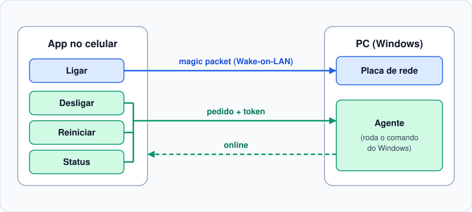

# Wake on LAN: controle seu PC pelo celular

Ligue, desligue, reinicie e veja o status do PC pelo celular, na rede de casa.

**Comece aqui:** faça os 3 passos abaixo, em ordem. Tempo total: cerca de 30 minutos.

| Passo | O que é | Tempo |
| --- | --- | --- |
| [1. Preparar o PC](#passo-1-preparar-o-pc) | Ajustes na BIOS e no Windows | ~15 min (inclui 1 reinício) |
| [2. Instalar o agente](#passo-2-instalar-o-agente-no-pc) | Programinha que recebe os comandos no PC | ~10 min |
| [3. Configurar o app](#passo-3-configurar-o-app) | Preencher IP, MAC e token no celular | ~2 min |

Requisito: celular e PC no **mesmo roteador**. Pela internet não funciona.

---

## O que o app faz

| Botão | Ação |
| --- | --- |
| **Ligar** | Acorda o PC desligado |
| **Desligar** | Desliga o PC (pede confirmação) |
| **Reiniciar** | Reinicia o PC (pede confirmação) |
| **Status** | Mostra **Online** ou **Offline**, atualiza a cada 5 segundos |

## Como funciona



| Você toca em | O celular envia | Quem recebe no PC | Resultado |
| --- | --- | --- | --- |
| **Ligar** | "magic packet" (Wake-on-LAN) | placa de rede | o PC liga |
| **Desligar** | pedido + token | agente | o PC desliga |
| **Reiniciar** | pedido + token | agente | o PC reinicia |
| **Status** | pedido + token | agente | **Online** se o agente responder, **Offline** se não |

- **Placa de rede**: escuta o "magic packet" mesmo com o PC desligado.
- **Agente**: programa que roda no PC e só obedece a quem manda o **token** certo (uma senha).

---

## Passo 1: Preparar o PC

Tempo: ~15 minutos. O que falha se você pular:

- Sem o **1a** ou o item 1-2 do **1b**: o botão **Ligar** não funciona.
- Sem a **rede Privada** (1b, item 3) ou sem o **IP** (1c): **nenhum** botão funciona.

### 1a. Cabo e BIOS (~5 min, exige reiniciar)

1. Ligue o PC no **cabo de rede**. Acordar pelo Wi-Fi quase nunca funciona. O celular pode ficar no Wi-Fi.
2. Reinicie e entre na BIOS/UEFI (tecla `Del` ou `F2` na inicialização).
3. Ative **Wake on LAN**. Às vezes o nome é *Power On By PCI-E*.
4. Se existir **ErP/EuP Ready**, desative.
5. Salve e saia.

### 1b. Windows (~5 min)

1. **Gerenciador de Dispositivos > Adaptadores de rede > placa de cabo > Propriedades**:
   - aba **Avançado**: ative **Wake on Magic Packet**;
   - aba **Gerenciamento de Energia**: marque **Permitir que este dispositivo acorde o computador** e **Permitir apenas um magic packet...**.
2. **Painel de Controle > Opções de Energia > Escolher a função dos botões de energia**: desmarque **Ligar inicialização rápida**.
3. **Configurações > Rede e Internet > Ethernet**: marque **Rede privada**.

### 1c. Anotar IP e MAC (~2 min)

1. Rode `ipconfig /all`.
2. Procure o adaptador **Ethernet**. Ignore o Wi-Fi e o "vEthernet".
3. Anote:
   - **Endereço IPv4**: é o IP (ex.: `192.168.1.50`)
   - **Endereço Físico**: é o MAC (ex.: `AA-BB-CC-DD-EE-FF`)

Opcional (~5 min): no roteador, crie uma **reserva de DHCP** para esse MAC. Sem isso, o IP do PC pode mudar e o app perde o PC.

**Pronto quando:** você tem o IP e o MAC anotados.

---

## Passo 2: Instalar o agente no PC

Tempo: ~10 minutos. Precisa do Flutter instalado (ele já traz o Dart).

1. Compile o agente. Na pasta do projeto:

   ```powershell
   cd agent
   dart pub get
   dart compile exe bin/agent.dart -o agent.exe
   ```

2. Abra o PowerShell **como Administrador** na pasta `agent` e copie o exe para um lugar fixo:

   ```powershell
   New-Item -ItemType Directory -Force 'C:\Program Files\WolAgent'
   Copy-Item .\agent.exe 'C:\Program Files\WolAgent\agent.exe'
   ```

   Por que `Program Files`: fica fora do OneDrive e só administradores conseguem alterar o arquivo.

3. Gere o token e **copie o valor**. Ele vai no app no Passo 3:

   ```powershell
   $token = [Convert]::ToBase64String([Security.Cryptography.RandomNumberGenerator]::GetBytes(32)).TrimEnd('=').Replace('+','-').Replace('/','_')
   $token
   ```

   Regra do token: **16 caracteres ou mais**, só letras, números, `_` ou `-`. Token fraco = o agente não inicia.

4. Instale, no mesmo PowerShell de Administrador:

   ```powershell
   .\install.ps1 -Token $token -ExePath 'C:\Program Files\WolAgent\agent.exe'
   ```

   Isso faz o agente iniciar junto com o Windows (tarefa `WolAgent`) e libera a porta `8765` no firewall, só em rede Privada.

5. Teste:

   ```powershell
   curl.exe -H "Authorization: Bearer $token" http://localhost:8765/status
   ```

**Pronto quando:** a resposta for `{"status":"online"}`.

---

## Passo 3: Configurar o app

Tempo: ~2 minutos.

1. Instale o app no celular (veja [Para desenvolvedores](#para-desenvolvedores)).
2. Toque na **engrenagem** (canto superior direito).
3. Preencha:

   | Campo | O que colocar |
   | --- | --- |
   | IP do PC | o IPv4 do Passo 1c |
   | MAC | o Endereço Físico do Passo 1c (aceita `:` ou `-`) |
   | Endereço de broadcast | deixe `255.255.255.255` |
   | Porta do agente | `8765` |
   | Token do agente | o token do Passo 2 |

4. Toque em **Salvar**.

**Pronto quando:** a tela mostrar **Online**.

Ao tocar em **Ligar**, a tela mostra **"Ligando..."** até o Windows subir: de 30 segundos a 3 minutos.

---

## Deu problema?

### O PC está ligado, mas o app mostra Offline

Teste na ordem:

1. **Agente parado ou não instalado.** Rode `Get-ScheduledTask WolAgent`. Se der erro, refaça o Passo 2.
2. **Rede do PC como Pública.** Mude para **Privada** (Passo 1b, item 3).
3. **Token diferente no app e no PC.** Digite no app o mesmo token usado no `install.ps1`. Depois de 5 tokens errados, o agente bloqueia o celular por **1 minuto**: corrija o token e espere 1 minuto.
4. **IP do PC mudou.** Rode `ipconfig` de novo e atualize no app.
5. **Celular em outra rede** (4G, Wi-Fi de visitas). Conecte no Wi-Fi de casa.

### O botão Ligar não acorda o PC

1. **PC no Wi-Fi.** Use cabo.
2. **BIOS ou placa de rede sem Wake on LAN.** Refaça o Passo 1a e o item 1 do Passo 1b.
3. **Inicialização Rápida ativa.** Refaça o Passo 1b, item 2.
4. **Broadcast não chega.** No app, troque o broadcast para o final `.255` da sua rede (ex.: `192.168.1.255`).

### O build falha com "non-ASCII characters"

Causa: a pasta do projeto tem acento (ex.: "Área de Trabalho"). Correção: mova o projeto para um caminho sem acento, ex.: `C:\dev\wakeonlan`.

---

## Atualizar o agente

Faça isto sempre que mudar o código em `agent/`. Tempo: ~3 minutos. O token não muda.

1. Compile, na pasta `agent`:

   ```powershell
   dart compile exe bin/agent.dart -o agent.exe
   ```

2. No PowerShell **como Administrador**, na pasta `agent`, troque o arquivo:

   ```powershell
   Stop-ScheduledTask WolAgent
   Copy-Item .\agent.exe 'C:\Program Files\WolAgent\agent.exe' -Force
   Start-ScheduledTask WolAgent
   ```

   Se o `Copy-Item` disser que o arquivo está em uso, espere 5 segundos e rode o `Copy-Item` e o `Start-ScheduledTask` de novo.

**Pronto quando:** o app mostrar **Online** de novo.

---

## Desinstalar o agente

Tempo: ~1 minuto. No PowerShell **como Administrador**:

```powershell
Unregister-ScheduledTask WolAgent -Confirm:$false
Remove-NetFirewallRule -DisplayName WolAgent
Remove-Item 'C:\Program Files\WolAgent' -Recurse
```

---

## Segurança

Protegido:

- Sem o token certo, o agente recusa **tudo** (erro 401).
- 5 tokens errados seguidos bloqueiam aquele aparelho por 1 minuto (erro 429). Adivinhar o token por tentativa fica inviável.
- O agente só roda `C:\Windows\System32\shutdown.exe` com argumentos fixos. Nada que chega pela rede vira comando.

Atenção:

- A comunicação é **HTTP sem criptografia**: alguém conectado na mesma rede consegue ver o token. Por isso, **nunca** abra a porta `8765` no roteador para a internet, e troque o token se alguém estranho usar sua rede.
- Quem tiver o seu token consegue desligar o seu PC. Para trocar: rode o `install.ps1` com um token novo e atualize o app.

---

## Para desenvolvedores

### Onde está cada coisa

| Caminho | Conteúdo |
| --- | --- |
| `lib/main.dart` | Telas do app (principal e configurações) |
| `lib/pc_controller.dart` | Magic packet e chamadas ao agente |
| `lib/settings.dart` | Configurações salvas e validação de IP e MAC |
| `agent/` | Agente do PC (servidor HTTP em Dart puro) e `install.ps1` |

### Rotas do agente

Todas exigem `Authorization: Bearer <token>`. Sem token ou com token errado: `401`. Depois de 5 erros do mesmo IP: `429` por 1 minuto.

| Método | Rota | Efeito |
| --- | --- | --- |
| GET | `/status` | `{"status":"online"}` |
| POST | `/shutdown` | `shutdown /s /t 0` |
| POST | `/restart` | `shutdown /r /t 0` |

O agente também lê `WOL_AGENT_TOKEN` e `WOL_AGENT_PORT` das variáveis de ambiente.

### Rodar e testar

```bash
flutter pub get
flutter run                     # celular conectado via USB
flutter build apk --release     # gera build/app/outputs/flutter-apk/app-release.apk
flutter test
cd agent && dart test
```

No Windows, o build Android, o `flutter analyze` e o `dart test` falham se o caminho da pasta tiver acento.
